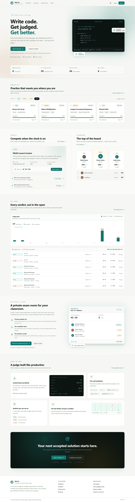
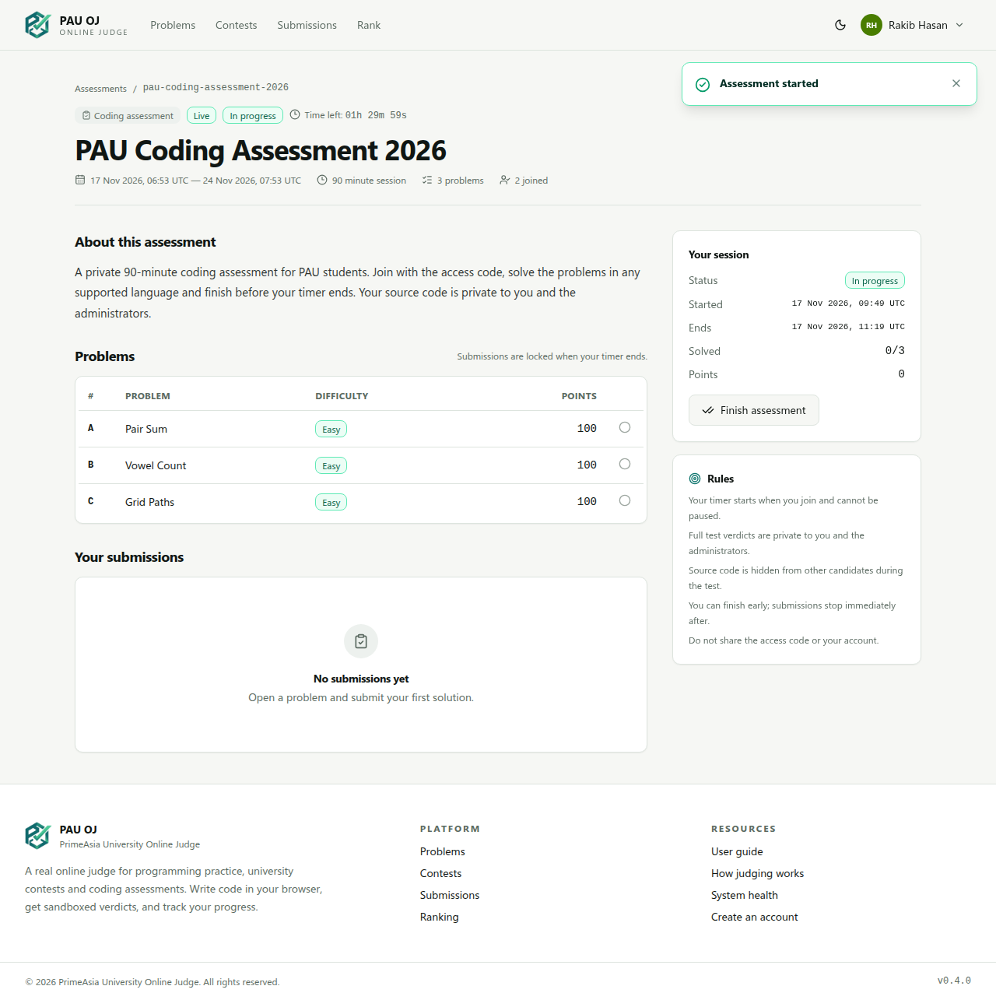

# PAU OJ


**Version 0.5.0.** A full-stack online judge for PrimeAsia University: browse problems, write code in
the browser, get sandboxed verdicts, compete in ICPC-style contests, run timed assessments and track
progress. `PAU-OJ-Design/` is the design reference; this is the working judge.

## Screenshots





## Features

### Judging
- **Real judging** — compile once, run each test in a locked-down Docker container with CPU, memory,
  process, file-size and wall-clock limits.
- **Ten languages** — C17, C++20, Python 3.11, Java 17, JavaScript (Node 24), C# (Mono), Go, PHP,
  Kotlin and Swift.
- **Verdicts** — Accepted, Wrong Answer, Time Limit, Memory Limit, Runtime Error, Compilation Error,
  Output Limit and System Error, with per-test results.
- **Output checkers** — `EXACT` (whitespace-normalized), `TOKEN`, `FLOAT` tolerance and `CUSTOM`
  Python checkers, run after submission with no network access.
- **Live updates & custom tests** — verdicts stream over SSE; run sample input without a submission.

### Practice & community
- **Problems** — Markdown statements, samples, tags, difficulty, points, post-accept editorial
  unlocking, community ratings, verified resources, related practice, search and solved status.
- **Problem contributions** — author-reviewed proposals for statements, tests and editorials, with
  private drafts, an audit log, CSV export and optional rejudge of practice submissions.
- **Study plans and daily practice** — curated lists with progress, a deterministic daily challenge
  with a streak, and category/subcategory/company filters.
- **Discussions** — one-level threads with votes, moderation and auto-lock during live contests or
  assessments.
- **Editor** — self-hosted Monaco with language-aware drafts saved in the browser.
- **Profiles** — points/rank/streak, rating graph, language/verdict analytics, solved lists,
  institution/country, badges and editorial credits.
- **Insights** — a Recharts 14-day activity chart and a 365-day submission heatmap.

### Contests
- **Contests** — registration, divisions, contest-only problems, ICPC scoreboard with penalties,
  live standings, clarifications, ratings, virtual replays, a freeze window and an admin editor.
- **Problem approvals** — another setter's problems need approval before publication; drafts stay
  private, admins can publish immediately, and approval is individual or bulk.
- **Contest integrity** — admins review code-similarity signals before acting; advisory only.

### Assessments & roles
- **Coding assessments** — private timed tests with one shared access code, per-candidate timers,
  early finish, private problems and submissions, and admin results.
- **Accounts** — Argon2id passwords, opaque database sessions, email verification, password reset,
  profile settings, session-revoking password changes and admin moderation.
- **Teacher workspace** — own problems, contests and assessments, scoped to created content; admins
  can review the workspace.
- **Admin** — activity chart, problem/test/contest editors, roles and suspension, rejudge and review
  analytics.

### Platform
- **Notifications** — in-app verdict, contest, clarification, review and approval notices, with
  per-category email preferences, token unsubscribe, digests and a weekly admin report.
- **Dashboards** — one responsive shell for coder, teacher and admin; coder stats, review panels with
  7/30/all-time filters and 48-hour flags, and a version/changelog footer.
- **Production plumbing** — migrations, seeds, Docker Compose, worker heartbeats, health checks,
  Caddy HTTPS, backups/restore, deploy scripts, CI and Vitest.

## Stack

| Layer | Technology |
| --- | --- |
| Web | Next.js 16 (App Router), React 19, TypeScript, Tailwind CSS 4 (light/dark) |
| Data | PostgreSQL 17 + Drizzle ORM |
| Queue | Redis 8 + BullMQ 6 |
| Judge | Node.js worker + Docker sandbox image |
| Editor / charts | Monaco 0.57 (self-hosted) + Recharts 3 |
| Tests & tooling | Vitest, pnpm 10, ESLint, esbuild |

## Quick start (Docker)

Prerequisites: Docker with Compose and `git`. Node.js is only needed for local development.

```bash
cp .env.example .env
# Edit .env: change passwords and set APP_URL if needed.
# Build the app image and the language sandbox image.
docker compose --profile build build
# Start Postgres, Redis, the web app and the worker.
docker compose up -d --wait
# Seed the admin account, problems and contests (run once).
docker compose --profile seed run --rm seed
curl http://localhost:3000/health
```

Open <http://localhost:3000>. The seed prints the admin username; the password is
`SEED_ADMIN_PASSWORD` from `.env` (example: `ChangeMe123!`). Demo data adds four coders (`rakib`,
`nusrat`, `tanvir`, `sadia` / `Demo@12345`), a teacher (`teacher` / `Demo@12345`), a live contest and
the assessment `/assessments/pau-coding-assessment-2026` (code `PAU-TEST-2026`). Mailpit at
<http://localhost:8025> catches verification and reset email.

Set `SEED_DEMO_DATA=false` before a production seed. If 5432/6379 are taken, change `POSTGRES_PORT` /
`REDIS_PORT` and matching `DATABASE_URL` / `REDIS_URL`.

## Local development

```bash
cp .env.example .env
pnpm install
pnpm setup          # starts Postgres/Redis, migrates, seeds, builds the judge image
pnpm dev            # web app on http://localhost:3000
# In a second terminal:
pnpm worker:start
```

`pnpm setup` is idempotent for development but re-applies seed data; never use it on production.

```bash
pnpm db:generate     # generate a migration after schema changes
pnpm db:migrate      # apply migrations
pnpm db:seed         # seed admin/problems/contests/demo data
pnpm db:studio       # Drizzle Studio
pnpm judge:build     # rebuild the main language sandbox image
pnpm judge:build:swift # rebuild the Swift sandbox image
pnpm build:worker    # bundle dist/worker.js, dist/migrate.js, dist/seed.js
pnpm verify          # hygiene, lint, typecheck, tests, build
```

## Judge and sandbox

The worker creates one container per compile and one per run:

- `--network none`, `--cap-drop ALL`, read-only root with a small writable `/tmp`; `--memory`,
  `--memory-swap`, `--cpus` and `--pids-limit` enforced by cgroups.
- Submitted processes run as `nobody` with strict `RLIMIT_*` limits, their own session and
  read-only source mounts; test inputs arrive on stdin.
- Hidden tests live in a root-only directory, unreadable by submitted code. Compilation defaults to
  30s (Kotlin at least 90s, Swift 60s), each test has its own wall-clock timeout, output is capped at
  2 MB per stream.

The sandbox image (`judge/Dockerfile`) bakes in the Python test harness. The worker scratch directory
must be bind-mounted at the same absolute path on the host and inside the worker, or the host Docker
daemon cannot mount test files into judge containers (Compose uses `/var/lib/pauoj/judge`). The worker
needs the host Docker socket (`/var/run/docker.sock`), a privileged capability; never expose it to
the web container. For public deployments, use a dedicated judge host and consider rootless Docker,
gVisor, Kata Containers or Firecracker.

See [docs/architecture.md](docs/architecture.md#judge-sandbox) for the full design.

## Languages

| Language | Version | Notes |
| --- | --- | --- |
| C | GCC 12, C17 | |
| C++ | G++ 12, C++20 | STL available |
| Python | CPython 3.11 | `sys.stdin` / `print` |
| Java | OpenJDK 17 | public class must be `Main` |
| JavaScript | Node.js 24 | stdin via `fs.readFileSync(0)` |
| C# | Mono 6.8 | compiled with `mcs`, run with `mono` |
| Go | Go 1.19 | `go build`, static binary |
| PHP | PHP 8.2 | `php -l` then CLI |
| Kotlin | Kotlin 1.3 on JDK 17 | compiled to a self-contained JAR |
| Swift | Swift 5.10 | separate `pauoj/judge-swift` image |

## Environment variables

`.env.example` is the source of truth; copy it to `.env` and edit.

| Variable | Purpose |
| --- | --- |
| `APP_URL` | Public origin used for cookies/links, e.g. `https://oj.example.edu` |
| `DATABASE_URL` | PostgreSQL connection string |
| `REDIS_URL` | Redis connection string |
| `POSTGRES_DB`, `POSTGRES_USER`, `POSTGRES_PASSWORD` | Compose database credentials |
| `POSTGRES_PORT`, `REDIS_PORT` | Local Compose host ports |
| `JUDGE_IMAGE` | Sandbox image tag, default `pauoj/judge:latest` |
| `JUDGE_SWIFT_IMAGE` | Swift sandbox image tag, default `pauoj/judge-swift:latest` |
| `JUDGE_WORK_DIR` | Worker scratch directory for local development |
| `JUDGE_HOST_DIR` | Host bind path; must match the path inside the worker |
| `JUDGE_CONCURRENCY` | Simultaneous judge jobs per worker |
| `JUDGE_COMPILE_TIMEOUT_MS` | Compile timeout, default 30s |
| `SEED_ADMIN_*` | Initial administrator account for `pnpm db:seed` |
| `SEED_DEMO_DATA` | Create demo users/submissions (`true` for local only) |
| `SMTP_HOST`, `SMTP_PORT`, `SMTP_SECURE` | SMTP server for verification/reset email |
| `SMTP_USER`, `SMTP_PASSWORD`, `MAIL_FROM` | SMTP credentials and sender |
| `MAILPIT_UI_PORT`, `MAILPIT_SMTP_PORT` | Dev Mailpit host ports (defaults 8025/1025) |

Never commit `.env`. Set `SEED_ADMIN_PASSWORD` before the first seed; changing it later does not
update an existing admin account, so edit that from Settings.

## API

All app routes are under `/api/v1`. Success: `{ "data": ..., "meta": { "page": 1, "pageSize": 20,
"total": 42 } }`; error: `{ "error": { "code": "...", "message": "...", "details": [] } }`.

| Method | Path | Auth | Purpose |
| --- | --- | --- | --- |
| POST/GET | `/auth/register`, `/auth/login`, `/auth/logout`, `/auth/me` | public / user | Account and session |
| GET | `/problems`, `/problems/:slug` | optional | List and detail (contest lock) |
| GET/POST | `/submissions`, `/submissions/:id`, `/submissions/:id/events` | optional/user | List, create, detail, SSE |
| POST | `/runs`, GET `/runs/:id` | user | Custom run and poll |
| GET/POST | `/contests`, `/contests/:slug/standings`, `/contests/:slug/register` | optional/user | Contest and scoreboard |
| POST | `/assessments/:slug/join`, `/assessments/:slug/finish` | user | Assessment session |
| POST/PUT | `/admin/problems`, `/admin/contests`, `/admin/assessments` | admin/teacher | Content management |
| GET | `/rank`, `/health` | public | Ranking and health |

Full reference: [docs/api.md](docs/api.md) (contributions, discussions, admin actions, notifications).

## Project structure

```text
src/app/            Pages and /api/v1 route handlers
src/components/     UI primitives, layout, shared and feature components
src/features/       Editor/submit, contests, submissions, admin forms
src/lib/            Shared types, formatting, API client and pure helpers
src/server/         Auth, API helpers, DB schema/services, judge engine
src/worker/         BullMQ worker entrypoint
judge/              Sandbox Dockerfiles + Python test harness
drizzle/            Generated SQL migrations
scripts/            Setup, verification, Monaco and worker builds
docs/               Developer documentation (start at docs/INDEX.md)
PAU-OJ-Design/      Original static design reference (separate repo, not built)
```

## Testing and verification

```bash
pnpm lint
pnpm typecheck
pnpm test
pnpm build
pnpm build:worker
curl http://localhost:3000/health
```

`pnpm verify` runs hygiene, lint, typecheck, tests and build in one step. The release end-to-end check
covered accepted C, C++, Python, Java and JavaScript; WA/CE/TLE/RE and custom runs; sandbox writes;
auth, profile, rank, standings and admin pages; SSE verdicts and rejudge; source visibility and locked
problems; and the assessment join → submit → finish → results flow.

## Deployment

Put a TLS proxy (Caddy, Nginx, Traefik) in front of port 3000; set a strong `APP_URL`, database
password, admin password and `SEED_DEMO_DATA=false`; seed once (migrations run on app start). Keep
Postgres/Redis private, back up `pgdata` with `pg_dump`, and use a dedicated judge host when possible.

Runbook: [deploy/README.md](deploy/README.md). Guide: [docs/deployment.md](docs/deployment.md).

## Known limitations

- Scoreboard is computed on demand; very large contests will want a cache.
- Similarity signals are advisory only; there is no automatic penalty or disqualification.
- Assessments use one shared access code; per-candidate email invites are not implemented.
- No object storage for very large test files; tests live in PostgreSQL text columns.
- No team contests.

These are deliberate v1 boundaries; the judge and core workflows are functional.

## Documentation

- [docs/INDEX.md](docs/INDEX.md) — map of every doc and where to write what.
- [docs/architecture.md](docs/architecture.md) — runtime, submission flow, data model, auth,
  contests, dashboards, sandbox.
- [docs/api.md](docs/api.md) — full `/api/v1` reference.
- [docs/deployment.md](docs/deployment.md) and [deploy/README.md](deploy/README.md) — deployment
  guide and production runbook.
- [CHANGELOG.md](CHANGELOG.md) — release history (also rendered at `/changelog`).
