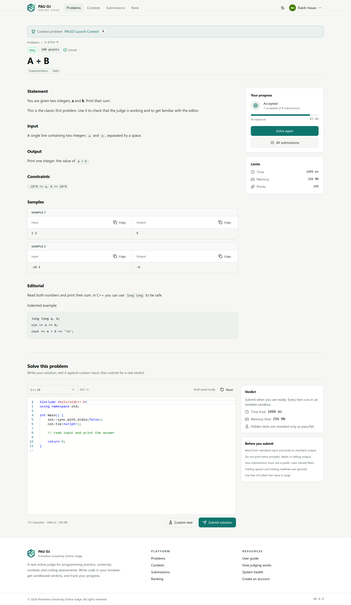

# PAU OJ


**Version 0.9.0.** A full-stack online judge for PrimeAsia University: browse problems, write code in
the browser, get sandboxed verdicts, compete in ICPC-style contests, run timed assessments and track
progress. `PAU-OJ-Design/` is the design reference; this is the working judge.

## Screenshots





## Features

### Judging
- **Real judging** — compile once, run each test in a locked-down Docker container with CPU, memory,
  process, file-size and wall-clock limits.
- **Ten languages** — C17, C++20, Python 3.11, Java 17, JavaScript (Node 24), C# (Mono), Go, PHP,
  Kotlin and Swift, plus SQL on real SQLite, MariaDB/MySQL and PostgreSQL engines.
- **Verdicts** — Accepted, Wrong Answer, Time Limit, Memory Limit, Runtime Error, Compilation Error,
  Output Limit and System Error, with per-test results.
- **Output checkers** — `EXACT` (whitespace-normalized), `TOKEN`, `FLOAT` tolerance and `CUSTOM`
  Python checkers, run after submission with no network access.
- **Live updates & custom tests** — verdicts stream over SSE; run sample input without a submission.

### Practice & community
- **Problems** — Markdown statements with a toolbar editor (headings, code, links, images, live
  preview), samples, tags, difficulty, points, post-accept editorial unlocking, community ratings,
  verified resources, related practice, search and solved status.
- **Problem contributions** — author-reviewed proposals for statements, tests and editorials, with
  the same Markdown editor and an editorial outline, private drafts, an audit log, CSV export and
  optional rejudge of practice submissions.
- **Problem publication review** — new problems never reach the public list on day one: two other
  setters must each approve it with a reference solution, an editorial and a reviewer-added test are
  required, a hold blocks every approval until the author responds and the hold is resolved, and
  published reviews earn contribution credit.
- **Reviewer leaderboard** — a public `/reviewers` board ranks reviewers by completed
  contribution decisions, with 7/30/all-time filters, approval rate, turnaround time, a top-3
  podium and a mobile-safe table.
- **Two leaderboards** — `/rank` switches between a practice-points board and a
  contest-rating board. The rating board only includes coders with finalized rated solo
  contests, showing current and peak rating, contest count and last change, with tier filters,
  rating/peak/contests sorting and Codeforces-style tier-coloured handles. Both boards support
  search, institution/country filters, page sizes and global ranks that filters never renumber.
- **Learning tracks** — a nine-track curriculum at `/learn` (seven algorithm tracks plus two
  project-driven SQL labs) with Bangla concept notes, professional concept-map diagrams, guided
  problems, tiered practice, extra self-try problems and timed checkpoint badges. Algorithm
  tracks unlock sequentially, and earned/locked badges appear on the profile. Two **free career
  toolkit** modules — Git & GitHub and Docker & CI/CD — teach the workflows a junior engineer uses
  on day one with story-driven notes, hands-on terminal labs, guided/solo drills and a timed
  checkpoint. They never require a purchase or a previous badge. Every topic also opens a
  **visual explainer** — a small animated SVG/CSS diagram that shows the mental model before the
  text, with a visible step list and a reduced-motion fallback.
- **Study plans and daily practice** — sectioned, level-tagged plans with estimated duration,
  featured picks, enrollment, per-section progress, next-problem resume, private learner-created
  plans and per-problem notes; a deterministic daily challenge with a streak; and
  category/subcategory/company filters.
- **Discussions** — one-level threads with votes, moderation and auto-lock during live contests or
  assessments.
- **Submission analysis** — an accepted run shows how its runtime and memory rank against
  accepted runs on the same problem (same language, widening to all languages for small samples),
  a runtime-distribution histogram with the run marked, a collapsible source panel, related
  practice pills and a private note for the author. Analysis stays hidden for assessments and
  live contests.
- **Editor** — self-hosted Monaco with language-aware drafts saved in the browser.
- **Profiles** — points/rank/streak, rating graph, language/verdict analytics, solved lists,
  institution/country, badges and editorial credits, website/GitHub/LinkedIn links, current
  status/company/job title/skills, a profile photo or one of twelve preset avatars,
  an approval-based follower/following graph with
  follow-request notifications and blocking, and one-click profile sharing with
  canonical/Open Graph metadata. Profiles and both ranking boards show "Online now"
  or a relative "Last active 7m/3h/2d/3w/4mo/1y ago" label (or "No recent activity"),
  with Everyone/Followers/Nobody visibility. Phone, address and T-shirt size stay
  private between the owner and admins.
- **Direct messages** — two-person inbox and threads unlocked by an accepted follow in
  either direction, with unread counts in the dashboard sidebar, read receipts, message
  deletion, per-conversation mute, in-app message/follow notice preferences, blocking, rate limits
  and strict participant-only access. Blocked conversations disappear from the inbox
  and their direct links return 404 until unblock.
- **Social reports** — report a message, conversation, follow request or profile with a
  reason and optional details. Duplicate submissions are rejected atomically, admins
  triage from `/admin/social-reports` with an hourly grouped email digest, and
  resolving or dismissing notifies the reporter. Retention runs daily in the worker
  (old messages, closed reports and cleared last-active timestamps) and
  `pnpm social:retention` supports manual dry runs.
- **Insights** — a Recharts 14-day activity chart and a 365-day submission heatmap.

### Contests
- **Contest hub** — a next-up spotlight, status/format/division filters and compact
  contest rows with Dhaka-local start times, duration, entry counts and direct links.
- **Modern contest page** — optional organiser banner with a branded fallback, a full
  Markdown description, format/eligibility, organiser rules plus the standard platform
  policy, prizes/recognition, a state-aware hero CTA, Dhaka-local times, share and
  add-to-calendar (ICS) tools.
- **Solo and team rounds** — individual or 2–6 coder teams with captain transfer, team
  rosters and a team-aggregated ICPC scoreboard. Captains can invite coders by username
  with accept/decline, pending-invite cancellation and a shareable fallback code.
- **Monthly official series** — the worker creates the third-Sunday 10:00 Asia/Dhaka
  90-minute round automatically; the problem set stays sealed until the start.
- **Fresh problems only** — a new contest problem must never have appeared in another
  contest and stays private until its debut; reuse and public problems are rejected.
- **Crew protection** — directors, setters, editorial writers, testers and observers
  (including a contest problem's author and editorial/test contributors) cannot
  register, join a team or submit, and non-director crew cannot open running statements.
- **Contest integrity** — editorials are sealed during the round, statements carry a
  per-user watermark, copy/paste/print/context-menu/tab signals are logged, and admins
  review fundamentals plus code-similarity signals.
- **Sponsorships** — anyone can request a title/gold/silver/community sponsorship;
  approved sponsors are highlighted on the contest page and list card.
- **Community hosting** — any signed-in user can submit a full host request with a
  banner, ৳3,000–৳5,000 fee and TrxID; an admin converts it into a private draft contest.
- **Problem approvals** — another setter's problems need approval before publication;
  drafts stay private, admin-created contests approve their problems automatically,
  and approval is individual or bulk.
- **Live features** — registration, divisions, clarifications, ratings (finalised
  one hour after a contest ends, after the review/rejudge window), virtual replays
  (solo), a freeze window and an admin editor.

### Assessments & roles
- **Coding assessments** — private timed tests with per-candidate timers, early finish, private
  problems and submissions, and admin results. Each assessment picks a join mode: `OPEN_CODE`
  keeps one shared access code as the fallback, while `INVITE` disables the code and admits
  candidates only through a personal link.
- **Candidate invites and roster import** — paste a roster CSV to create one
  invite per candidate: `candidate_ref` is required, email/name/group are optional, and rows
  without an email are delivered by link only. Email-bearing invites can be sent, resent or
  revoked one at a time from the results page when SMTP is configured — each send or copy rotates
  the personal link so the previous one stops working — while no-email rows stay copy-link only.
  The roster-complete results CSV lists every candidate, including those who never started.
- **Accounts** — Argon2id passwords, opaque database sessions, email verification, password reset,
  profile settings, session-revoking password changes and admin moderation.
- **Teacher workspace** — own problems, contests and assessments, scoped to created content; admins
  can review the workspace.
- **Admin** — activity chart, problem/test/contest editors, roles and suspension, rejudge and review
  analytics.

### Platform
- **Notifications** — in-app and email notices for verdicts, contest registration/30-minute
  reminders/final results+rating, clarifications, reviews, learning enrollment/payments/reminders,
  badges and solved milestones, announcements, new contests/course modules, direct messages and
  problem/lesson replies. Per-category preferences, token unsubscribe, review digests, a weekly
  admin report and an admin announcement composer are included.
- **Dashboards** — one responsive shell for coder, teacher and admin; coder stats, review panels with
  7/30/all-time filters and 48-hour flags, and a version/changelog footer.
- **Production plumbing** — migrations, seeds, Docker Compose, worker heartbeats, health checks,
  Caddy HTTPS, backups/restore, deploy scripts, CI and Vitest.

## Problem publication review

Saving a new problem sends it into review. It stays out of the public practice list until the review
passes, so a work-in-progress problem never reaches solvers.

States (`problems.publication_status`):

| State | Meaning |
| --- | --- |
| `DRAFT` | The author is still writing; never public. |
| `IN_REVIEW` | Open to eligible reviewers; approvals are collected in the current review cycle. |
| `CHANGES_REQUESTED` | At least one hold is open or addressed; approvals are locked. |
| `PUBLISHED` | In the public problem list (terminal for this workflow). |

Who can do what:

| Action | Who | Effect |
| --- | --- | --- |
| `submit` | Author or admin | `DRAFT` → `IN_REVIEW`, review cycle +1 |
| `approve` | Any teacher/admin except the author | Records a reference solution; publishes when every gate passes |
| `hold` | Any teacher/admin except the author | `IN_REVIEW` → `CHANGES_REQUESTED`; approvals collected so far are superseded |
| `respond` | Author or admin | Answers a hold; the hold becomes `ADDRESSED` |
| `resolve` | The reviewer who raised the hold, or an admin | Last hold cleared: back to `IN_REVIEW`, review cycle +1 |
| `reopen` | The reviewer who raised the hold, or an admin | The hold returns to `OPEN` |
| `publish` | Author or admin | `IN_REVIEW` → `PUBLISHED` when every gate passes |
| `reopen_publication` | Author or admin | `PUBLISHED` → `DRAFT`; hides the problem from the public list, resets approvals and lets the author edit and submit it again |

Publish gates: two active approvals in the current review cycle, a non-empty editorial, at least one
test case added by a reviewer, at least one approval carrying a reference solution, and no open or
addressed hold. Reviewers are teachers and administrators who did not write the problem, and nobody
can approve their own problem. Approving reviewers get contribution credit when the problem is
published. A published problem that needs a change is withdrawn into a re-review; it leaves the
public list until it passes two fresh approvals again. Full state machine:
[docs/architecture.md](docs/architecture.md#problem-publication-review).

## Stack

| Layer | Technology |
| --- | --- |
| Web | Next.js 16 (App Router), React 19, TypeScript, Tailwind CSS 4 (light/dark) |
| Data | PostgreSQL 17 + Drizzle ORM |
| Queue | Redis 8 + BullMQ 6 |
| Judge | Node.js worker + Docker sandbox image |
| Editor / charts | Monaco 0.57 (self-hosted) + Recharts 3 |
| Tests & tooling | Vitest, pnpm 10, ESLint, esbuild |

## Quick start (Docker)

Prerequisites: Docker with Compose and `git`. Node.js is only needed for local development.

```bash
cp .env.example .env
# Edit .env: change passwords and set APP_URL if needed.
# Build the app image and the language sandbox image.
docker compose --profile build build
# Start Postgres, Redis, the web app and the worker.
docker compose up -d --wait
# Seed the admin account, problems and contests (run once).
docker compose --profile seed run --rm seed
curl http://localhost:3000/health
```

Open <http://localhost:3000>. The seed prints the admin username; the password is
`SEED_ADMIN_PASSWORD` from `.env` (example: `ChangeMe123!`). Demo data adds four coders (`rakib`,
`nusrat`, `tanvir`, `sadia` / `Demo@12345`), a teacher (`teacher` / `Demo@12345`), a live contest and
the assessment `/assessments/pau-coding-assessment-2026` (code `PAU-TEST-2026`). Mailpit at
<http://localhost:8025> catches verification and reset email.

Set `SEED_DEMO_DATA=false` before a production seed. If 5432/6379 are taken, change `POSTGRES_PORT` /
`REDIS_PORT` and matching `DATABASE_URL` / `REDIS_URL`.

## Local development

```bash
cp .env.example .env
pnpm install
pnpm setup          # starts Postgres/Redis, migrates, seeds, builds the judge image
pnpm dev            # web app on http://localhost:3000
# In a second terminal:
pnpm worker:start
```

`pnpm setup` is idempotent for development but re-applies seed data; never use it on production.

```bash
pnpm db:generate     # generate a migration after schema changes
pnpm db:migrate      # apply migrations
pnpm db:seed         # seed admin/problems/contests/demo data
pnpm db:studio       # Drizzle Studio
pnpm judge:build     # rebuild the main language sandbox image
pnpm judge:build:swift # rebuild the Swift sandbox image
pnpm build:worker    # bundle dist/worker.js, dist/migrate.js, dist/seed.js
pnpm verify          # hygiene, lint, typecheck, tests, build
```

## Judge and sandbox

The worker creates one container per compile and one per run:

- `--network none`, `--cap-drop ALL`, read-only root with a small writable `/tmp`; `--memory`,
  `--memory-swap`, `--cpus` and `--pids-limit` enforced by cgroups.
- Submitted processes run as `nobody` with strict `RLIMIT_*` limits, their own session and
  read-only source mounts; test inputs arrive on stdin.
- Hidden tests live in a root-only directory, unreadable by submitted code. Compilation defaults to
  30s (Kotlin at least 90s, Swift 60s), each test has its own wall-clock timeout, output is capped at
  2 MB per stream.

The sandbox image (`judge/Dockerfile`) bakes in the Python test harness. The worker scratch directory
must be bind-mounted at the same absolute path on the host and inside the worker, or the host Docker
daemon cannot mount test files into judge containers (Compose uses `/var/lib/pauoj/judge`). The worker
needs the host Docker socket (`/var/run/docker.sock`), a privileged capability; never expose it to
the web container. For public deployments, use a dedicated judge host and consider rootless Docker,
gVisor, Kata Containers or Firecracker.

See [docs/architecture.md](docs/architecture.md#judge-sandbox) for the full design.

## Languages

| Language | Version | Notes |
| --- | --- | --- |
| C | GCC 12, C17 | |
| C++ | G++ 12, C++20 | STL available |
| Python | CPython 3.11 | `sys.stdin` / `print` |
| Java | OpenJDK 17 | public class must be `Main` |
| JavaScript | Node.js 24 | stdin via `fs.readFileSync(0)` |
| C# | Mono 6.8 | compiled with `mcs`, run with `mono` |
| Go | Go 1.19 | `go build`, static binary |
| PHP | PHP 8.2 | `php -l` then CLI |
| Kotlin | Kotlin 1.3 on JDK 17 | compiled to a self-contained JAR |
| Swift | Swift 5.10 | separate `pauoj/judge-swift` image |
| SQL | SQLite 3 | portable SQL option; read-only ShopSphere fixture |
| SQLite | SQLite 3 | native SQLite 3; script labs run here |
| MySQL | MariaDB 10.11 | real server, SELECT-only role, one statement |
| PostgreSQL | PostgreSQL 15 | real server, SELECT-only role, one statement |

SQL problems offer four choices backed by three real engines. MySQL and
PostgreSQL each boot a private server in the sandbox; script-mode labs (DDL/DML
and transactions) are SQLite-only.

## Environment variables

`.env.example` is the source of truth; copy it to `.env` and edit.

| Variable | Purpose |
| --- | --- |
| `APP_URL` | Public origin used for cookies/links, e.g. `https://oj.example.edu` |
| `DATABASE_URL` | PostgreSQL connection string |
| `REDIS_URL` | Redis connection string |
| `POSTGRES_DB`, `POSTGRES_USER`, `POSTGRES_PASSWORD` | Compose database credentials |
| `POSTGRES_PORT`, `REDIS_PORT` | Local Compose host ports |
| `JUDGE_IMAGE` | Sandbox image tag, default `pauoj/judge:latest` |
| `JUDGE_SWIFT_IMAGE` | Swift sandbox image tag, default `pauoj/judge-swift:latest` |
| `JUDGE_WORK_DIR` | Worker scratch directory for local development |
| `JUDGE_HOST_DIR` | Host bind path; must match the path inside the worker |
| `JUDGE_CONCURRENCY` | Simultaneous judge jobs per worker |
| `JUDGE_COMPILE_TIMEOUT_MS` | Compile timeout, default 30s |
| `SEED_ADMIN_*` | Initial administrator account for `pnpm db:seed` |
| `SEED_DEMO_DATA` | Create demo users/submissions (`true` for local only) |
| `SMTP_HOST`, `SMTP_PORT`, `SMTP_SECURE` | SMTP server for verification/reset email |
| `SMTP_USER`, `SMTP_PASSWORD`, `MAIL_FROM` | SMTP credentials and sender |
| `MAILPIT_UI_PORT`, `MAILPIT_SMTP_PORT` | Dev Mailpit host ports (defaults 8025/1025) |

Never commit `.env`. Set `SEED_ADMIN_PASSWORD` before the first seed; changing it later does not
update an existing admin account, so edit that from Settings.

## API

All app routes are under `/api/v1`. Success: `{ "data": ..., "meta": { "page": 1, "pageSize": 20,
"total": 42 } }`; error: `{ "error": { "code": "...", "message": "...", "details": [] } }`.

| Method | Path | Auth | Purpose |
| --- | --- | --- | --- |
| POST/GET | `/auth/register`, `/auth/login`, `/auth/logout`, `/auth/me` | public / user | Account and session |
| GET | `/problems`, `/problems/:slug` | optional | List and detail (contest lock) |
| GET/POST | `/submissions`, `/submissions/:id`, `/submissions/:id/events` | optional/user | List, create, detail, SSE |
| GET/PUT/DELETE | `/submissions/:id/analysis`, `/submissions/:id/notes` | optional/user | Distribution summary, private note |
| POST | `/runs`, GET `/runs/:id` | user | Custom run and poll |
| GET/POST | `/contests`, `/contests/:slug/standings`, `/contests/:slug/register` | optional/user | Contest and scoreboard |
| POST/DELETE | `/contests/:slug/teams`, `/contests/:slug/teams/join`, `/contests/:slug/teams/leave` | user | Team formation and registration |
| POST/PATCH/DELETE | `/contests/:slug/teams/invites[/:id]` | user | Invite, accept/decline or cancel a teammate invitation |
| POST | `/contests/:slug/sponsors`, `/contests/host-requests` | user | Sponsorship and community hosting |
| POST | `/contests/:slug/integrity-events` | participant | Watermark/copy/tab integrity signal |
| GET/PATCH | `/admin/host-requests`, `/admin/contests/:id/operations`, `/admin/contest-series` | admin/crew | Contest operations |
| POST | `/assessments/:slug/join` (access code or invite token), `/assessments/:slug/finish` | user | Assessment session |
| GET | `/assessments/:slug/invites/:token` | public | Read-only invite metadata |
| GET/POST | `/admin/assessments/:id/invites` | admin/teacher | Roster list and CSV import |
| POST | `/admin/assessments/:id/invites/:inviteId/rotate` | admin/teacher | Re-issue a personal link |
| POST | `/admin/assessments/:id/invites/:inviteId/send` | admin/teacher | Send or resend one invite email |
| POST | `/admin/assessments/:id/invites/:inviteId/revoke` | admin/teacher | Revoke one invite link |
| GET | `/admin/assessments/:id/results.csv` | admin/teacher | Roster-complete results export |
| POST/PUT | `/admin/problems`, `/admin/contests`, `/admin/assessments` | admin/teacher | Content management |
| GET/POST | `/problem-reviews/:problemId` | author/staff | Publication review workspace and actions |
| POST | `/learning/checkpoints` | user | Start or resume a timed module checkpoint |
| GET | `/rank`, `/health` | public | Ranking and health |

Full reference: [docs/api.md](docs/api.md) (contributions, discussions, admin actions, notifications,
invite claim rules and error codes).

## Project structure

```text
src/app/            Pages and /api/v1 route handlers
src/components/     UI primitives, layout, shared and feature components
src/features/       Editor/submit, contests, submissions, admin forms
src/lib/            Shared types, formatting, API client and pure helpers
src/server/         Auth, API helpers, DB schema/services, judge engine
src/worker/         BullMQ worker entrypoint
judge/              Sandbox Dockerfiles + Python test harness
drizzle/            Generated SQL migrations
scripts/            Setup, verification, Monaco and worker builds
docs/               Developer documentation (start at docs/INDEX.md)
PAU-OJ-Design/      Original static design reference (separate repo, not built)
```

## Testing and verification

```bash
pnpm lint
pnpm typecheck
pnpm test
pnpm learning:check
pnpm learning:audit
pnpm build
pnpm build:worker
curl http://localhost:3000/health
```

`pnpm verify` runs hygiene, lint, typecheck, tests and build in one step. The release end-to-end check
covered accepted C, C++, Python, Java and JavaScript; WA/CE/TLE/RE and custom runs; sandbox writes;
auth, profile, rank, standings and admin pages; SSE verdicts and rejudge; source visibility and locked
problems; and the assessment join → submit → finish → results flow.

## Deployment

Put a TLS proxy (Caddy, Nginx, Traefik) in front of port 3000; set a strong `APP_URL`, database
password, admin password and `SEED_DEMO_DATA=false`; seed once (migrations run on app start). Keep
Postgres/Redis private, back up `pgdata` with `pg_dump`, and use a dedicated judge host when possible.

Runbook: [deploy/README.md](deploy/README.md). Guide: [docs/deployment.md](docs/deployment.md).

## Known limitations

- Scoreboard is computed on demand; very large contests will want a cache.
- Similarity signals are advisory only; there is no automatic penalty or disqualification.
- Assessments fall back to one shared access code. Invite email goes out one candidate at a time —
  no send-all, no scheduled retry or reminder — and needs SMTP with an authenticated sending
  domain (SPF/DKIM/DMARC) at deployment. Link-only invites work without SMTP.
- No object storage for very large test files; tests live in PostgreSQL text columns.
- Team contests are unrated and virtual replay is solo-only. A monthly auto-created
  contest starts with a sealed/empty problem set until staff attach fresh problems.
- Team invitations are in-app notifications only; there is no invite email yet.
- Notification emails are queued in `email_outbox` and retried with backoff (five attempts, up to 100
  per 30-second worker tick) but still require a verified address; the welcome mail is the only
  pre-verification email. Delivered rows are pruned after 30 days and failed rows after 90. There is
  no web push or notification grouping yet. Milestone and badge notices fire on exact thresholds, and
  learning inactivity reminders are sent once per module and threshold (7 and 21 days).
- Announcements and marketing are queued and delivered by the worker within about 30 seconds; the
  admin request does not block on audience size. In-app and email marketing are independent
  switches. New-module marketing is detected by the worker comparing live modules to the broadcast
  ledger, so it runs on the next worker start or hourly sweep. Contest results reach every registered
  participant, with a generic final-standings notice when there is no rating change.
- Contest banners are supplied as public https image URLs (or the branded default);
  there is no direct image-upload pipeline yet.
- Contest watermarks, copy guards and integrity events are deterrents and review
  signals; they cannot prevent an OS or phone screenshot, and they never apply an
  automatic penalty.
- Fresh contest problems stay out of the practice list until the normal publication
  review after the round; the public contest page still opens them after the end.
- All seven core learning tracks and both SQL labs ship. Every core topic has the full
  3-easy / 3-medium / 2-hard practice tier plus two or three extra problems. The two free
  career-toolkit modules add three workshop topics each, with two guided and two solo drills per
  topic and a three-problem checkpoint; their lessons are story-driven and their terminal labs
  run on the learner's own machine, not inside the judge. The SQL tracks share
  `/learn/sql/project`, an industry-project dossier with seven squads, 23 work
  tickets, a 19-table data dictionary, metric definitions, a handover checklist
  and a downloadable SQLite fixture. Every lesson has previous/next navigation
  (the first links to the track overview, the last to the checkpoint), module
  pages offer previous/next track navigation, and the SQL delivery board follows
  curriculum order.
- Problem publication review is staff-only: only teachers and administrators can approve, hold,
  resolve or reopen, and coders only see the status of problems they authored. The public problem
  list shows published problems only — contest-only problems and private drafts never appear there.
- Problem content is locked while it is in review or published; a fix needs a reviewer to put the
  problem on hold first. A published problem can be withdrawn into a re-review, but it leaves the
  public list until it passes two fresh approvals again. Statement/test contributions are rejected
  in those states; a published problem accepts editorial proposals only.
- Existing problems were backfilled by the publication migration: public problems became
  `PUBLISHED`, private ones `DRAFT`. Nothing that was public before is hidden now.

These are deliberate v1 boundaries; the judge and core workflows are functional.

## Documentation

- [docs/INDEX.md](docs/INDEX.md) — map of every doc and where to write what.
- [docs/architecture.md](docs/architecture.md) — runtime, submission flow, data model, auth,
  contests, assessments and invite delivery, dashboards, sandbox.
- [docs/api.md](docs/api.md) — full `/api/v1` reference.
- [docs/deployment.md](docs/deployment.md) and [deploy/README.md](deploy/README.md) — deployment
  guide and production runbook.
- [CHANGELOG.md](CHANGELOG.md) — release history (also rendered at `/changelog`).
